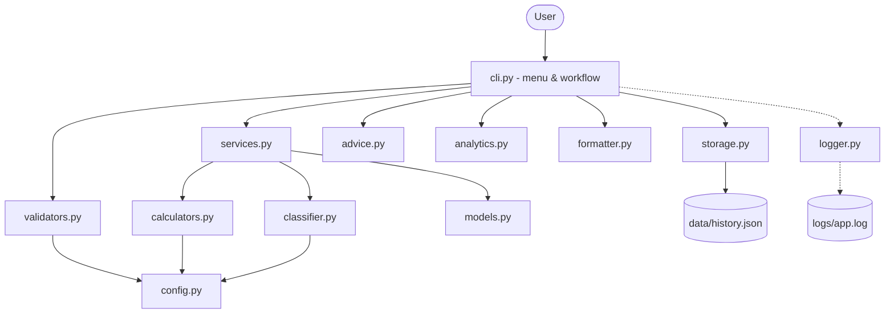
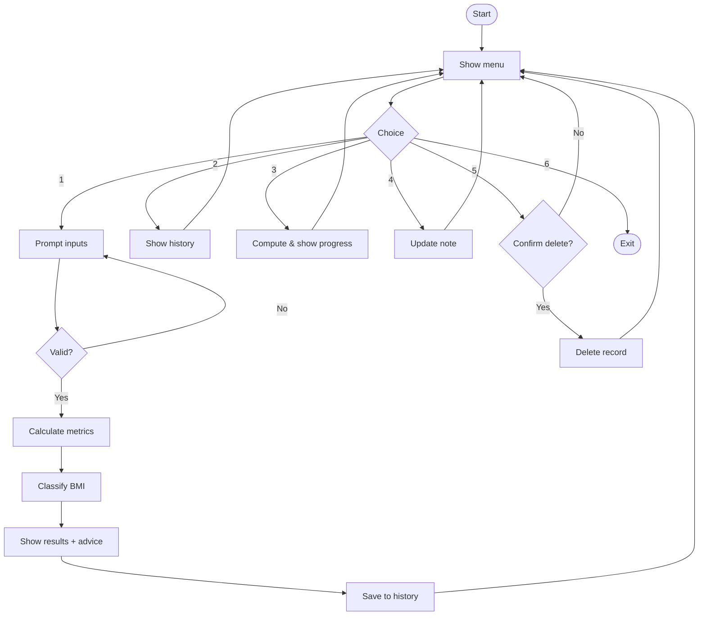
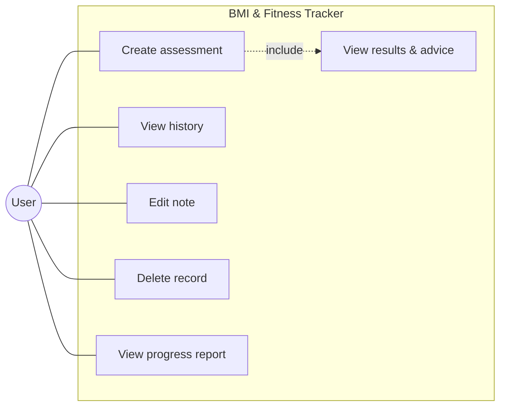
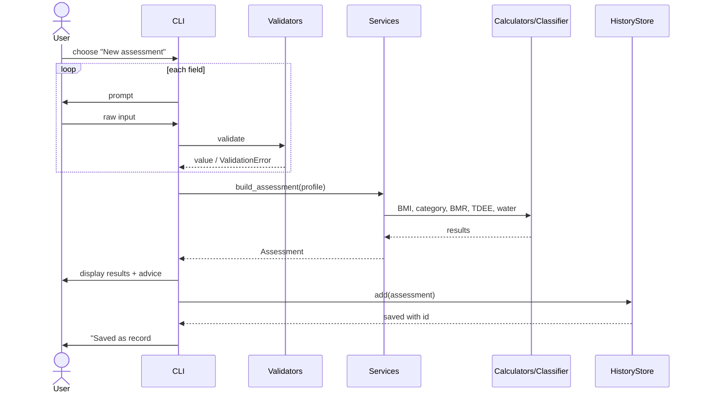
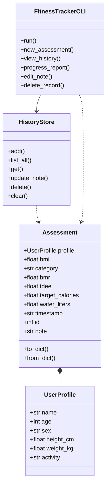
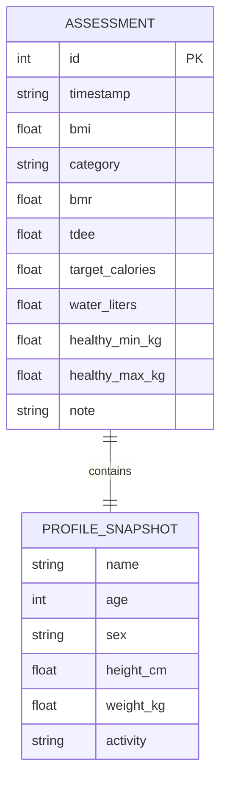

# Design Documentation

Diagrams use Mermaid (renders on GitHub; or paste into https://mermaid.live to export PNG for your PDF report).

## 1. Functional Requirements
- **FR1** Collect name, age, sex, height, weight, activity level with validation.
- **FR2** Calculate BMI, BMR, TDEE, calorie target, water intake, healthy weight range.
- **FR3** Classify BMI (WHO) and show colour-coded result + suggestions.
- **FR4** Save each assessment; view history (Read).
- **FR5** Add/edit a note (Update); delete a record (Delete, with confirmation).
- **FR6** Progress report: weight change, trend, average BMI.

## 2. Non-Functional Requirements
| # | Type | Requirement | How it is met |
|---|---|---|---|
| NFR1 | Usability | Clear prompts, re-prompt on error, `cancel` anywhere, colour output | `cli.ask()`, `formatter.py` |
| NFR2 | Reliability | No data loss on crash; recover from corrupt file | Atomic write (temp + rename), `.corrupt` backup |
| NFR3 | Error handling | Invalid input never crashes app | `validators.py` + `ValidationError`, last-resort handler in `main.py` |
| NFR4 | Maintainability | Modular, single-responsibility, documented, tested | 11 modules, 62 unit tests |
| NFR5 | Logging | Events/errors recorded to file | `logger.py` rotating log |
| NFR6 | Performance / Efficiency | Instant response, no external dependencies | Pure functions, stdlib only |
| NFR7 | Security / Privacy | Data stays local; no network access | JSON file on local disk |

## 3. System Architecture

## 4. Workflow Diagram

## 5. Use Case Diagram

## 6. Sequence Diagram (New Assessment)

## 7. Class Diagram

## 8. Storage Design (ER / Schema)

Stored as a JSON array in `data/history.json`; each element is one assessment with its embedded profile snapshot.

## 9. Design Decisions & Rationale
- **JSON over SQLite:** small, human-readable data; zero setup. SQLite is listed as a future upgrade.
- **Pure calculation functions:** easy to unit test, no I/O side effects.
- **Dependency-injected I/O in CLI** (`input_fn`, `output_fn`): allows automated testing of interactive flows.
- **Mifflin-St Jeor** BMR: considered more accurate for modern populations than Harris-Benedict.
- **Snapshot profile per record:** each record is self-contained, so history stays correct even if a user's details change.
- **Atomic writes:** prevents half-written files.

## 10. Testing Approach
Unit tests (pytest) per module + CLI integration tests with simulated input; boundary-value tests for BMI categories and validation ranges; failure-path tests for corrupt storage.

## 11. Report Outline Mapping (PDF Section 6)
Cover Page -> Introduction (README overview) -> Problem Statement (statement.md) -> FR/NFR (section 1-2 above) -> Architecture (3) -> Diagrams (4-8) -> Decisions (9) -> Implementation (module list in README) -> Screenshots (run app & capture) -> Testing (10) -> Challenges (e.g. float rounding in tests, corrupt-file handling, testable CLI) -> Learnings -> Future Enhancements -> References (WHO BMI classification; Mifflin et al., 1990, Am J Clin Nutr).
